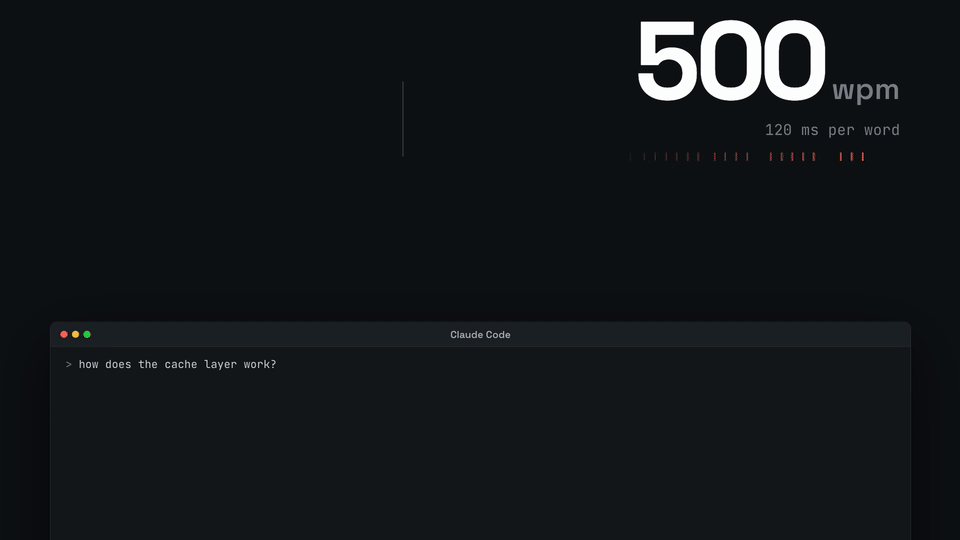

# rsvp-reader

Speed-read Claude's last answer inside the Claude Code session, one word at a time, Spritz style (rapid serial visual presentation). The pane shows a single word with its recognition-point letter highlighted in red at a fixed column, so the eye never moves; reading speed is adjustable.



*Fifteen seconds of the explainer: type `/rsvp`, the countdown, the word stream, a sentence skip and play. The full 60-second video with narration is attached to the [latest release](https://github.com/maximhoffman/rsvp-reader/releases/latest) (`rsvp-reader-explainer.mp4`); the animated page it is rendered from is `docs/explainer/index.html` (open it in a browser and press Play).*

## Use

Type `/rsvp` after an answer. The pane opens beside the transcript with the keyboard focus and starts playing. `/rsvp 450` also sets the speed in words per minute (100 to 1000; the setting is remembered across sessions).

Playback starts after a three-second countdown, the first word standing still. Every seek (a word or a sentence either way) stops on the word it lands on; `p` continues from there. Keys while the pane holds the focus: `p` pause/play, `r` restart (with the countdown), `q` or Escape close; `h` / `l` one word back / forward; `j` start of the sentence (pressed there, the previous sentence), `k` next sentence; `a` slower, `d` faster.

Code blocks are skipped (shown as one placeholder token); headings, lists, links, tables and emphasis are flattened to prose. Sentence ends and commas get a longer pause.

## Language

The buttons and messages are in English by default. The install screen offers a `language` option (`en` or `ru`); later it is changed in `/config` under the plugin's row, or by setting `pluginConfigs.rsvp-reader.options.language` in `~/.claude/settings.json`. The text being read can be in any language.

## Install

At the prompt of a Claude Code terminal session:

```
/plugin install rsvp-reader --marketplace maximhoffman/rsvp-reader
```

Answer `y` to add the marketplace, then pick a scope (user scope installs it for every session). From a shell the same is `claude plugin install rsvp-reader --marketplace maximhoffman/rsvp-reader`. In the desktop app, where `/plugin` does not run: click + next to the prompt box, then Plugins, Add marketplace with `maximhoffman/rsvp-reader`, then Add plugin.

## Develop

`claude plugin validate .` checks the manifest and hooks; `claude plugin test .` runs the tests in `tests/`.

## License

MIT

## Explainer video

`docs/explainer/` holds the explainer as code: `index.html` is the 60-second animation (every scene a function of the master clock), `record.mjs` renders it frame by frame with [HyperFrames](https://github.com/heygen-com/hyperframes) and muxes the soundtrack, `soundtrack.mjs` builds the mix from `audio/` (ElevenLabs narration and music, synthesized sound effects timed from the page's own cues). The rendered MP4 is not in git; download it from the release.
